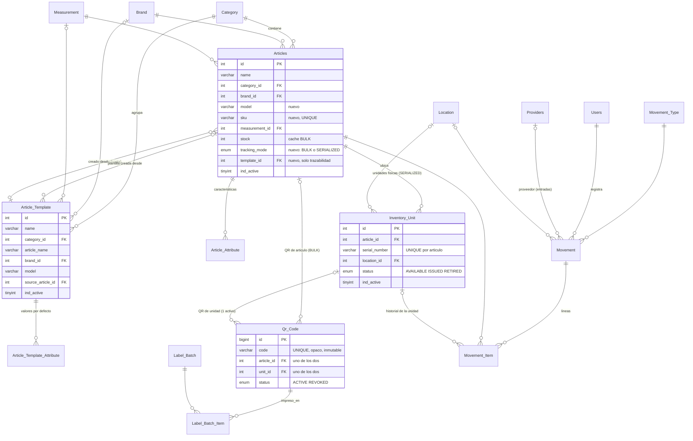

# Fase 1 · Diagnóstico y diseño: inventario con códigos QR

Fecha: 2026-11-11 · Estado: **PROPUESTA, pendiente de validación** (no se ha ejecutado nada contra ninguna base de datos real)

Archivos de esta fase:

| Archivo | Contenido |
|---|---|
| `db/migrations/000_preflight_checks.sql` | Consultas de solo lectura que deben devolver 0 filas antes de migrar |
| `db/migrations/001_qr_inventory.up.sql` | Migración propuesta |
| `db/migrations/001_qr_inventory.down.sql` | Reversión completa |

Verificado en MariaDB 10.11 local y desechable: original → UP → DOWN deja **el esquema y los datos idénticos** al original; UP se puede volver a aplicar; las 17 reglas de integridad de §5 se rechazan o aceptan según lo esperado. **No probado todavía en MySQL 8** (la sintaxis usada es compatible con MySQL 8.0.16+).

---

## 0. Hallazgo previo: hay tres modelos de datos que no coinciden

Antes de diseñar hay que resolver esto, porque decide sobre qué se construye el backend y el frontend.

| Pieza | Modelo de datos que usa |
|---|---|
| **SQL entregado** (`MR`) | Inglés: `Articles`, `Category`, `Brand`, `Measurement`, `Users(name, role_id)`; módulos con rutas `/articles`, `/entries`… e iconos de Tabler (`IconPick`, `IconCategory2`) |
| **MRAPI** (este repo) | Llama a procedimientos almacenados **que no están en el SQL**: `get_all_products`, `get_Prod_ByID`, `validateUserCredentials`, `CrearUsuario`. El login espera columnas `id_usuario, nombre, password, nombre_rol`, que no existen en `Users`/`Roles` |
| **MRFront** (React) | Español: `id_producto, nombre_producto, sku, precio_venta, stock_minimo, stock_maximo, atributos_extra, id_categoria, nombre_categoria, id_marca, id_unidadM`; rutas `/products`, `/categories/`, `/brands/`, `/um/`, `/access/:user`; iconos `lucide-react`. Ninguno de esos endpoints (salvo `/products`) existe en MRAPI |

Conclusión: o bien existe otra BD (la que usan los procedimientos y MRFront) o el SQL entregado es la versión nueva y el API y el front se quedaron atrás. **El diseño de este documento se basa en el SQL entregado**, como se pidió; ver la pregunta P0 en §7.

---

## 1. Inventario del esquema original

| Tabla | Filas semilla | PK | FKs (acción al borrar) | UNIQUE |
|---|---|---|---|---|
| Roles | 2 | id | — | name |
| Users | 1 | id | role_id → Roles (RESTRICT) | email |
| Modules | 10 | id | — | route |
| Role_Module | 14 | (role_id, module_id) | → Roles, Modules (CASCADE) | — |
| Providers | 4 | id | — | — |
| Email / Phone | 5 / 5 | id | provider_id → Providers (CASCADE) | email / phone |
| Category | 6 | id | — | **ninguno** |
| Measurement | 6 | id | — | **ninguno** |
| Brand | 4 | id | — | **ninguno** |
| Articles | 5 | id | category, brand, measurement (**CASCADE**) | **ninguno** |
| Movement_Type | 2 | id | — | **ninguno** |
| Movement | 0 | id | movement_type, user (**CASCADE**) | — |
| Movement_Item | 0 | id | movement, article (RESTRICT) | — |
| 4 vistas | — | — | — | — |

## 2. Diagnóstico

### 2.1 Qué se reutiliza tal cual
`Roles`, `Users`, `Modules`, `Role_Module`, `Providers`, `Email`, `Phone`, `Movement_Type`, `Movement`, `Movement_Item`, `Category`, `Brand`, `Measurement` y `Articles` **se conservan**. Ninguna tabla se elimina ni se renombra (romperíamos las vistas y lo que ya consuma este esquema).

### 2.2 Problemas de integridad (graves)

| # | Problema | Consecuencia | Propuesta |
|---|---|---|---|
| I1 | `Articles` → `Category/Brand/Measurement` con **ON DELETE CASCADE** | Borrar una categoría borra en cascada sus artículos. Si alguno tiene movimientos, el borrado falla por `Movement_Item` (sin CASCADE); si no, desaparecen sin rastro | `RESTRICT`. La baja se hace con `ind_active = 0` |
| I2 | `Movement` → `Users` y `Movement_Type` con **ON DELETE CASCADE** | Borrar un usuario intenta borrar sus movimientos: se pierde trazabilidad (o falla por `Movement_Item`) | `RESTRICT`. Los usuarios se desactivan con `ind_active` |
| I3 | Sin UNIQUE en `Category.name`, `Brand.name`, `Measurement.name`, `Movement_Type.name` | Duplicados («Pintura» dos veces) que luego rompen filtros y reportes | UNIQUE (comprobado antes con `000_preflight_checks.sql`) |
| I4 | `Articles` sin ninguna clave natural | Nada impide registrar dos veces el mismo producto | UNIQUE `(brand_id, model)` y `sku` (ver P3) |
| I5 | Sin CHECK: `stock`, `quantity`, precios pueden ser negativos o 0 | Existencias imposibles | CHECK `stock >= 0`, `quantity > 0`, precios `>= 0` |
| I6 | `Movement_Type.name` admite NULL | Tipo de movimiento sin nombre | `NOT NULL` |

### 2.3 Normalización y redundancias

| # | Observación | Propuesta |
|---|---|---|
| N1 | `Articles.stock` se guarda y además se puede calcular de los movimientos: dos fuentes de verdad, sin nada que las mantenga sincronizadas | Se mantiene como **caché** (lo usan las vistas), actualizada siempre en la misma transacción que el movimiento. Para artículos serializados la existencia real = nº de unidades disponibles (`VW_ARTICLE_STOCK`). La consulta 3 de `000_preflight_checks.sql` detecta desajustes |
| N2 | `Movement.total` y `Movement_Item.subtotal` son derivables | Se conservan (evitan recálculos y reflejan el precio del momento); el backend los calcula, no el cliente |
| N3 | No hay dónde guardar modelo ni características | `Articles.model` + tabla `Article_Attribute` (clave/valor) |
| N4 | `Movement` no registra proveedor (en entradas) ni ubicación ni observaciones | Columnas opcionales `provider_id`, `location_id`, `notes` |
| N5 | Nombres de tablas mezclan singular/plural (`Articles` vs `Category`) | **No se cambia**: renombrar rompe vistas y código. Las tablas nuevas usan singular |

### 2.4 Vistas existentes (se informan; **no se modifican** en 001)

| Vista | Problema |
|---|---|
| `VW_CRITICAL_STOCK` | Umbral fijo `stock <= 10` para todos los artículos (10 tornillos ≠ 10 taladros) e incluye inactivos |
| `VW_WITHOUT_ROTATION` | La columna se llama `last_sale` pero cuenta **cualquier** movimiento, incluidas entradas |
| `VW_TOTAL_SOLD_PER_WEEK` | Agrupa por `WEEK()` sin año: en enero las semanas 1–2 se ordenan antes que las 51–52 de diciembre |
| `VW_Best_Selling_Items_Of_Month` | Dice «del mes» pero no filtra por fecha (es histórico). El `LEFT JOIN` con `WHERE m.movement_type_id = 2` se comporta como `INNER JOIN` |

Corregirlas cambia lo que muestra el dashboard: lo dejo para una migración 002 si lo apruebas.

### 2.5 Calidad de los datos semilla (no se tocan; solo se informa)

| Artículo | Categoría | Marca | Unidad |
|---|---|---|---|
| Silicon acetico (300 ml) | Materiales de construcción | Makita | Centímetros |
| Aceite Multiusos (aerosol) | Suministros eléctricos | Cemex | Metros |
| Guantes Nylom | Materiales de construcción | Trupper | Metros |
| Resistol 850 (1 kg) | Materiales de construcción | Makita | Centímetros |
| Botas Jardineras | Tornillería | Cemex | Metros |

Las combinaciones parecen datos de relleno (silicón medido en cm, botas en «Tornillería»). Además: `Modules` contiene «Provedores» (falta una «e»), `Users.role_id` admite NULL y `Articles.ind_active` es `TINYINT` sin `(1)`.

### 2.6 Lo que falta para QR
No existe nada que represente: una **unidad física**, un **código QR**, una **plantilla**, una **ubicación** ni un **historial por unidad**.

---

## 3. Diseño propuesto

### 3.1 Separación de conceptos (y por qué)

| Concepto | Tabla | Qué es | Por qué separado |
|---|---|---|---|
| Categoría | `Category` (existente) | Agrupador | Ya resuelve su función |
| **Artículo** | `Articles` (existente, ampliada) | El *modelo* de catálogo: «Taladro Bosch GSB 13 RE». **No** es un objeto físico | Ya existe y lo usan movimientos y vistas |
| Característica | `Article_Attribute` (nueva) | Pares clave/valor: «Potencia = 650 W» | Cada categoría tiene características distintas; una columna JSON no se puede indexar ni validar bien y columnas fijas no escalan |
| **Plantilla** | `Article_Template` + `Article_Template_Attribute` (nuevas) | Valores por defecto para dar de alta artículos | Requisitos: «plantillas administrables», «no confundir plantillas con unidades» y «cambiar una plantilla no modifica lo ya registrado». Si la plantilla fuera el propio artículo, editarla *sería* editar el artículo |
| **Unidad física** | `Inventory_Unit` (nueva) | Un taladro concreto en el almacén | Para trazabilidad individual: estado, ubicación e historial propios |
| **Código QR** | `Qr_Code` (nueva) | Identificador opaco impreso en una etiqueta | Permite revocar y reimprimir (etiqueta dañada) sin perder el código anterior, etiquetar tanto artículos como unidades y garantizar en BD que un código nunca se reasigna. Una columna `qr` en `Articles` no permite nada de eso |
| Ubicación | `Location` (nueva) | Almacén / zona / estante | El módulo de inventario pide «consultar ubicación» |
| Lote de etiquetas | `Label_Batch` + `Label_Batch_Item` (nuevas) | Qué códigos se imprimieron, en qué hoja y posición | Relación inequívoca etiqueta ↔ unidad al imprimir hojas y poder reimprimir un lote |
| Movimiento | `Movement` / `Movement_Item` (existentes, ampliadas) | Entradas/salidas | `Movement_Item.unit_id` enlaza cada línea a la unidad → historial por unidad |

**Artículo de seguimiento por lote vs. serializado** (`Articles.tracking_mode`):
- `BULK` (todos los artículos actuales): se cuenta por cantidad (`Articles.stock`), como hoy. Tornillos, silicón, guantes. El QR identifica al **artículo** (etiqueta en el estante o en la caja).
- `SERIALIZED`: cada unidad física es una fila de `Inventory_Unit` con su **propio QR**. Taladros, herramientas, equipos.

### 3.2 Diagrama de relaciones



Cumplimiento de las relaciones pedidas:

1. Una categoría contiene muchos artículos → `Articles.category_id`.
2. Un artículo sirve de plantilla → «crear plantilla desde artículo» copia sus valores a `Article_Template` (`source_article_id` guarda el origen).
3. Una plantilla se usa muchas veces → `Articles.template_id` (N artículos por plantilla).
4. Cada unidad física tiene un QR único → `Qr_Code.unit_id` + UNIQUE `active_unit_id`.
5. El QR se resuelve en el backend → `GET /api/qr/:code` busca `Qr_Code.code`.
6. Movimientos ↔ unidad → `Movement_Item.unit_id`.
7. Historial por unidad → `VW_UNIT_HISTORY`.

### 3.3 Reglas garantizadas por la base de datos (no solo por el código)

| Regla de negocio | Mecanismo |
|---|---|
| Nunca reutilizar un QR entre dos unidades | `UNIQUE(code)` + trigger `trg_qr_code_immutable` (código y destino inmutables) + trigger `trg_qr_code_no_delete` |
| Como mucho un QR activo por unidad o artículo | Columnas generadas `active_unit_id` / `active_article_id` con UNIQUE |
| Un QR apunta a un único destino | `CHECK ((article_id IS NULL) <> (unit_id IS NULL))` |
| No usar el nombre como identificador | El nombre no es clave de nada; identidad = `id`, `sku`, `(brand_id, model)` y `Qr_Code.code` |
| Evitar duplicados | UNIQUE en catálogos, `(brand_id, model)`, `sku`, `(article_id, serial_number)`, `(movement_id, unit_id)`, `(category_id, template.name)` |
| No borrar registros con historial | FKs `RESTRICT` en todo lo que tiene historial; bajas con `ind_active`/`status` |
| Una unidad = cantidad 1 en un movimiento | `CHECK (unit_id IS NULL OR quantity = 1)` |
| Cambiar una plantilla no altera lo registrado | El alta **copia** valores; `template_id` es solo referencia histórica |

### 3.4 Contenido del QR

El QR **solo** contiene un código aleatorio, opaco y estable (p. ej. `MR7K2Q9X4HZT`), nunca nombre, precio ni descripción. El backend lo resuelve: `GET /api/qr/MR7K2Q9X4HZT` → artículo/unidad, estado y ubicación; o bien `404` (no existe) o `410` (revocado / desactivado). Ver la decisión P4 sobre si se codifica el código solo o una URL.

### 3.5 Flujo de alta con plantilla

```
Seleccionar categoría ──► listar artículos y plantillas activas de la categoría
        │
        ├─ (a) elegir PLANTILLA ─────────────┐
        └─ (b) elegir ARTÍCULO como base ────┤  GET devuelve valores para precargar
                                             ▼  (sin ids, sin QR, sin stock)
                          formulario precargado: el usuario modifica lo que cambie
                                             │
                     POST /api/articles  {…, template_id?, units: N?}
                                             │  TRANSACCIÓN:
                                             │   1. valida duplicados (brand+model, sku)
                                             │   2. INSERT Articles + Article_Attribute (copiados)
                                             │   3. si SERIALIZED y N>0: N × INSERT Inventory_Unit
                                             │   4. por cada artículo/unidad: código aleatorio → INSERT Qr_Code
                                             │      (si colisiona el UNIQUE, se genera otro y se reintenta)
                                             │   5. opcional: Movement «Entrada» con sus líneas y stock
                                             ▼  COMMIT (o ROLLBACK completo)
                          respuesta con los códigos nuevos → vista previa → PDF de etiquetas
```

Además, para un artículo que **ya existe** (otro taladro idéntico): `POST /api/articles/:id/units {count, location_id, serial_numbers?}` crea N unidades nuevas con N QR nuevos, sin crear otro artículo.

### 3.6 Escalabilidad (miles de artículos y unidades)
Índices en todos los filtros previstos (`category_id+ind_active`, `name`, `article_id+status`, `location_id`, `movement_type_id+created_at`, `unit_id`); listados paginados (`LIMIT/OFFSET` con tope); generación por lotes con inserciones múltiples dentro de una transacción; PDF de etiquetas generado en streaming.

---

## 4. Implementación prevista (Fases 3–4)

**Backend (MRAPI)**: mismo patrón `routes → controller → service`, mismo `errorHandler`/`HttpError`. Para lo nuevo se usará **SQL parametrizado desde Node** (`pool.execute` + `getConnection()` para transacciones) en lugar de procedimientos almacenados, porque las transacciones de varios pasos con reintento de código QR son más claras y testeables así. Los procedimientos actuales no se tocan. Dependencias nuevas: `qrcode` (PNG/SVG) y `pdfkit` (hojas de etiquetas).

| Método | Ruta | Uso |
|---|---|---|
| GET/POST | `/api/categories` | listar / crear |
| PUT/PATCH | `/api/categories/:id`, `/:id/status` | editar / activar-desactivar |
| GET | `/api/categories/:id/articles` | artículos de la categoría |
| GET/POST | `/api/articles` (`?category_id&q&page`) | listar / crear (con `template_id`, atributos y `units`) |
| GET/PUT/PATCH | `/api/articles/:id`, `/:id/status` | detalle / editar / desactivar |
| GET | `/api/articles/:id/prefill` | valores para usar un artículo como base |
| POST | `/api/articles/:id/units` | registrar N unidades nuevas con su QR |
| GET/POST/PUT/PATCH | `/api/templates`, `/api/templates/:id`, `/:id/status` | administrar plantillas |
| POST | `/api/templates/from-article/:articleId` | crear plantilla desde un artículo |
| GET | `/api/units` (`?q&category_id&location_id&status&page`) | inventario |
| GET/PATCH | `/api/units/:id`, `/:id/status` | detalle / estado |
| GET | `/api/units/:id/history` | historial de movimientos |
| GET | `/api/qr/:code` | resolver un QR escaneado |
| GET | `/api/qr/:code/image?format=png\|svg` | descargar la imagen del QR |
| POST | `/api/qr/:code/revoke` | revocar y emitir uno nuevo |
| POST | `/api/labels` `{codes[], layout}` | PDF con hoja de etiquetas (registra `Label_Batch`) |
| GET/POST | `/api/locations` | ubicaciones |
| GET | `/api/movements` (`?article_id&unit_id&from&to`) | historial general |

**Frontend (MRFront)**: se reutilizan `Header`, `Input`, `Select`, `Button`, `fetchData`, el layout con `Outlet`, `menuItems` y el estilo Bootstrap/lucide existentes. Páginas nuevas: Categorías, Artículos (alta + QR), Alta rápida (categoría → plantilla/artículo → formulario precargado → N unidades → etiquetas), Inventario (búsqueda por nombre/categoría/código, escaneo con cámara, ubicación, estado e historial). Para leer QR con la cámara: `html5-qrcode` (o un lector USB, que funciona como un teclado).

---

## 5. Pruebas realizadas en esta fase

En MariaDB 10.11 local con el SQL original cargado:

| Prueba | Resultado |
|---|---|
| `000_preflight_checks.sql` sobre los datos originales | 0 filas (no hay bloqueos) |
| UP | ✅ |
| DOWN → comparación con el original | ✅ esquema idéntico (incluidas las acciones `CASCADE` originales) y datos idénticos |
| UP de nuevo tras DOWN | ✅ |
| Las 4 vistas originales siguen funcionando | ✅ |
| Categoría duplicada | ✅ rechazada |
| Mismo código QR en otra unidad | ✅ rechazado |
| Reasignar un QR a otra unidad | ✅ rechazado (trigger) |
| Segundo QR activo para la misma unidad | ✅ rechazado |
| QR sin destino o con dos destinos | ✅ rechazado |
| Borrar físicamente un QR | ✅ rechazado (trigger) |
| Revocar un QR y emitir uno nuevo para la unidad | ✅ aceptado |
| Reactivar un QR revocado | ✅ rechazado |
| Borrar una categoría con artículos (antes CASCADE) | ✅ rechazado |
| Borrar un usuario con movimientos (antes CASCADE) | ✅ rechazado |
| Borrar una unidad con historial | ✅ rechazado |
| Línea de movimiento de una unidad con cantidad 2 | ✅ rechazada |
| La misma unidad dos veces en un movimiento | ✅ rechazada |
| Stock negativo | ✅ rechazado |
| Mismo modelo de la misma marca dos veces | ✅ rechazado |
| Mismo número de serie dos veces en un artículo | ✅ rechazado |

---

## 6. Cómo aplicar (cuando esté validado)

```bash
mysqldump --routines --triggers MR > MR_backup_$(date +%F).sql
mysql MR < db/migrations/000_preflight_checks.sql   # debe devolver 0 filas
mysql MR < db/migrations/001_qr_inventory.up.sql
# Revertir:
mysql MR < db/migrations/001_qr_inventory.down.sql
```

---

## 7. Decisiones que necesito que confirmes antes de implementar

| # | Decisión | Alternativas | Recomendación |
|---|---|---|---|
| **P0** | ¿Qué BD y qué frontend son los buenos? | (a) El SQL entregado (`MR`, inglés) es el canónico; MRAPI y MRFront se adaptan a él. (b) Hay otra BD (la de los procedimientos `get_all_products`, etc.) y hay que diseñar sobre esa | (a). Y confirmar que el frontend es **MRFront** (los `Modules` del SQL usan rutas `/articles` e iconos Tabler, que no coinciden con MRFront) |
| **P1** | ¿Qué crea el «alta rápida»? | (a) Un **artículo nuevo** (otro modelo: GSB 16 RE) a partir de una plantilla o artículo base. (b) **Unidades nuevas** del mismo artículo (otro GSB 13 RE). (c) Ambas, eligiendo en pantalla | (c) |
| **P2** | ¿Quién lleva QR? | (a) Solo las unidades `SERIALIZED`. (b) Unidades `SERIALIZED` **y** artículos `BULK` (un QR por artículo para estante o caja) | (b), que es lo que soporta la migración |
| **P3** | ¿Qué es un artículo duplicado? | (a) Misma marca + modelo (propuesto, `NULL` en modelo no cuenta). (b) Además, SKU único. (c) Otra regla | (a) + SKU opcional y único; el SKU lo genera el servidor (el de MRFront se basa en el nombre) |
| **P4** | ¿Qué se codifica en el QR? | (a) Solo el código: `MR7K2Q9X4HZT` (más pequeño, sirve con lectora USB). (b) Una URL: `https://<tu-dominio>/q/MR7K2Q9X4HZT` (la cámara de cualquier móvil abre la app) | (b), con dominio configurable. El código va impreso también en texto bajo el QR |
| **P5** | Estados de una unidad | Propuesto `AVAILABLE` (en almacén), `ISSUED` (salió), `RETIRED` (baja). ¿Hacen falta otros (préstamo, reparación, reservado…)? | Los 3 propuestos, ampliables |
| **P6** | Ubicaciones | (a) Lista plana (`Location`). (b) Jerárquica (almacén → pasillo → estante). (c) No se usan por ahora | (a) |
| **P7** | ¿El alta de unidades genera un movimiento de **Entrada**? | (a) Sí, automáticamente, con proveedor opcional (stock e historial coherentes desde el inicio). (b) No: el alta solo cataloga; la entrada se registra aparte | (a) |
| **P8** | Formato de etiquetas | (a) Carta 3×10 (tipo Avery 5160, 66,7×25,4 mm). (b) Rollo de impresora térmica (p. ej. 50×25 mm). (c) Otro | Diseño configurable; empezar por (a) si no hay impresora térmica |
| **P9** | Permisos | ¿Qué roles acceden a los módulos nuevos (Inventario, Alta rápida, Plantillas, Ubicaciones, Etiquetas)? | `administrador`: todos. `almacenista`: Inventario, Alta rápida y Etiquetas |
| **P10** | Vistas del dashboard (§2.4) | (a) Corregirlas en una migración 002. (b) Dejarlas | (a) |
